# E-commerce CDC Pipeline

[](https://github.com/munyingi/ecommerce-cdc-pipeline/actions/workflows/ci.yml)
**Live dashboard: [ecommerce-cdc-pipeline.streamlit.app](https://ecommerce-cdc-pipeline.streamlit.app/)**

An end-to-end **change data capture (CDC)** pipeline for a simulated online shop. Every insert,
update and delete in the shop's Postgres database is captured from the write-ahead log by
**Debezium**, streamed through **Kafka**, landed idempotently in a warehouse, and modelled with
**dbt** into a star schema with **SCD Type 2** history. A multi-page **Streamlit** dashboard
turns it into the metrics a real e-commerce company runs on: revenue, retention cohorts,
RFM segments, product concentration, price elasticity and fulfilment SLAs.

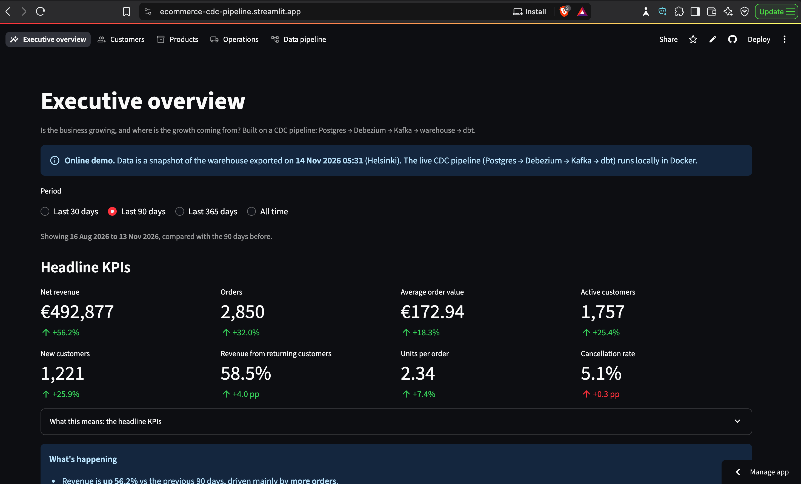

---

## Architecture

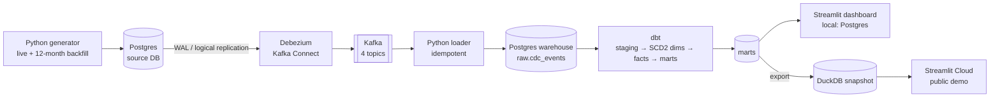

Everything runs locally with Docker Compose: source Postgres, Kafka (KRaft mode), Debezium,
Kafka UI and the warehouse Postgres.

| Layer | Tools |
|---|---|
| Source system | PostgreSQL 16 (`wal_level=logical`, `REPLICA IDENTITY FULL`), Python + Faker |
| Change data capture | Debezium 2.7 Postgres connector on Kafka Connect (`pgoutput`) |
| Streaming | Apache Kafka 3.8 (KRaft, no Zookeeper), Kafka UI |
| Ingestion | Python, `confluent-kafka`, `psycopg` |
| Warehouse | PostgreSQL 16 (local), DuckDB (online demo) |
| Transformation | dbt Core 1.12 (55 data tests) |
| Dashboard | Streamlit, Altair |
| CI/CD | GitHub Actions, Streamlit Community Cloud |

---

## How it works

### 1. A shop that keeps changing
`generator/generate.py` behaves like a live shop: new customers and orders, orders moving through
`placed → paid → shipped → delivered`, cancellations, customers moving city, price changes and
GDPR-style deletions. `generator/backfill.py` writes **12 months of realistic history** through the
same path: growth, weekly and hourly patterns, Black Friday and the December rush, loyal versus
one-time customers, demand that reacts to price, and slower deliveries to cities further from the
warehouse.

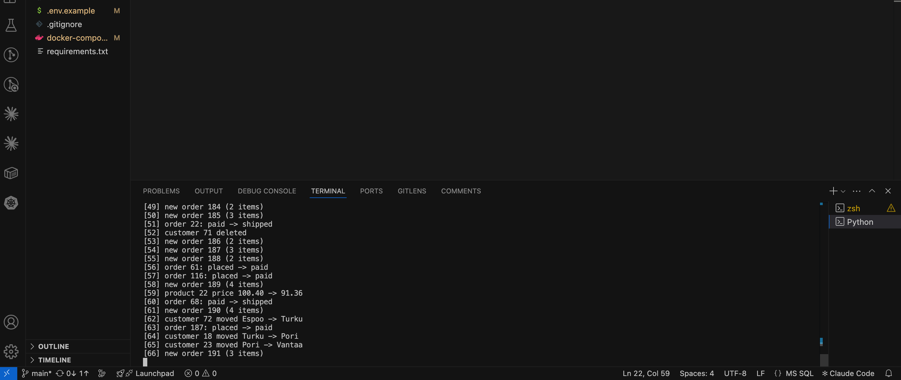

### 2. Change data capture with Debezium
Debezium reads Postgres's write-ahead log through a replication slot and publishes every row change
to Kafka, one topic per table. Each event carries the row **before** and **after** the change, the
operation (`c`, `u`, `d`, `r`), the commit timestamp and the log sequence number (LSN).

| Topics in Kafka | An update event: a customer moves from Tampere to Lahti |
|---|---|
| 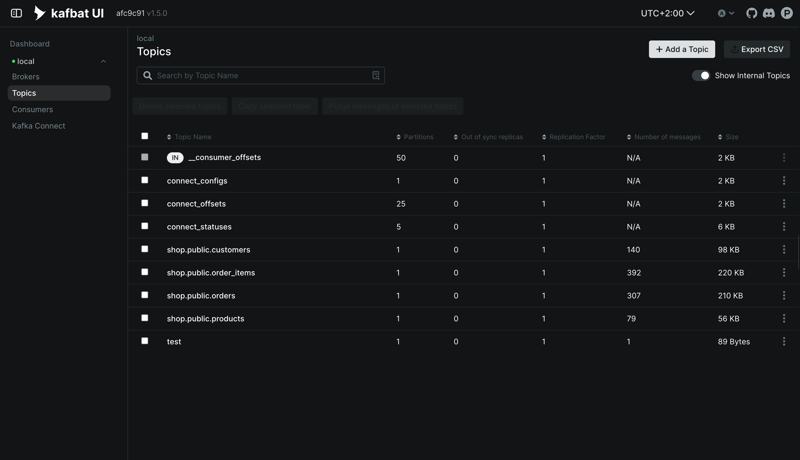 | 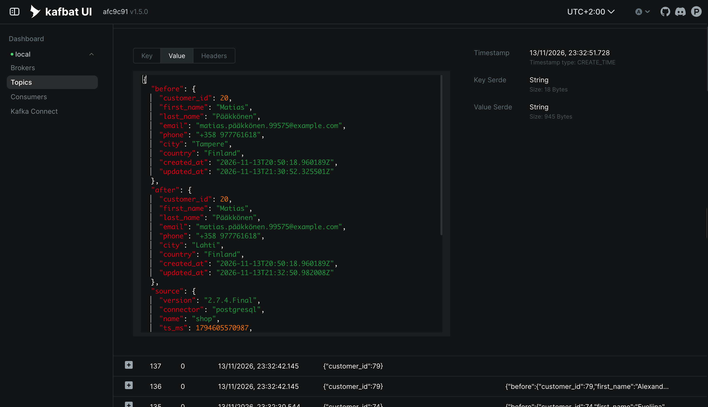 |

### 3. Idempotent loading
`consumer/load_cdc.py` lands every event, unchanged, in `raw.cdc_events`. Kafka guarantees
*at-least-once* delivery, so the loader:
- writes a batch first and commits the Kafka offset **only after** the warehouse transaction succeeds, and
- has a unique key on `(topic, partition, offset)` with `ON CONFLICT DO NOTHING`.

Tested by resetting the consumer group to the earliest offset and replaying everything:
**zero duplicates** (1,039 rows before and after).

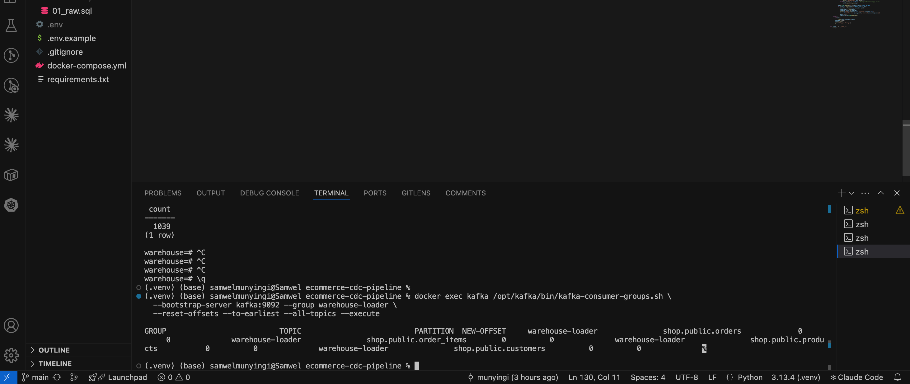

### 4. dbt: from change events to a star schema

| Layer | Models | What happens |
|---|---|---|
| **staging** | `stg_customers`, `stg_products`, `stg_orders`, `stg_order_items` | JSON parsed into typed columns; Debezium re-sends deduplicated on (key, LSN, op) |
| **dimensions** | `dim_customer`, `dim_product` (SCD Type 2), `dim_date` | One row per version with `valid_from` / `valid_to` |
| **facts** | `fct_order_items`, `fct_orders` | Point-in-time joins to the dimension version valid at order time; order lifecycle timestamps |
| **marts** | `mart_daily_kpis`, `mart_customer_metrics`, `mart_cohort_retention`, `mart_product_performance`, `mart_product_price_versions` | Metrics ready for the dashboard |

**SCD Type 2 built from CDC events.** Customer 20 moved three times; the warehouse keeps every
version, and each order links to the version that was valid when it was placed:

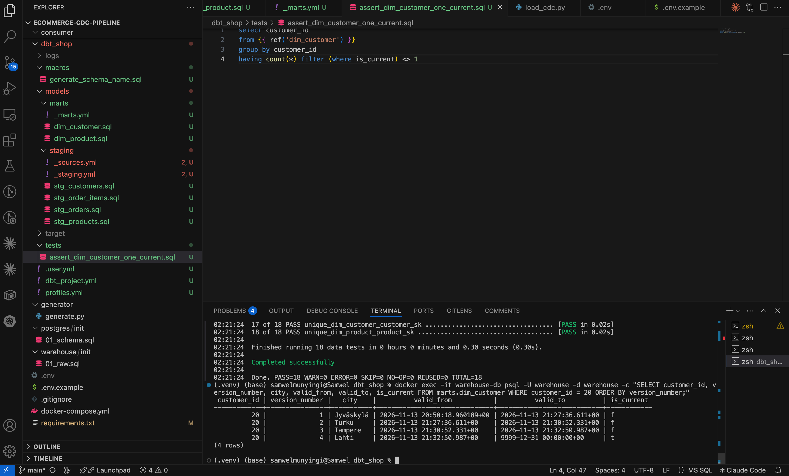

Orders credited to the city the customer lived in **at the time**, not where they live now:

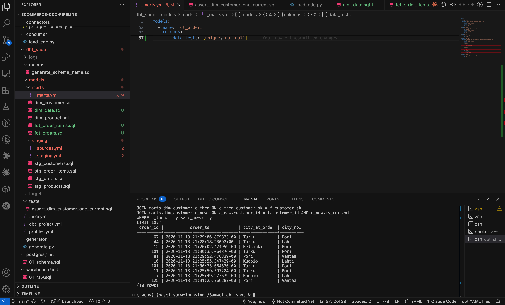

### 5. Dashboard
Five pages, each chart with a "What this means" explanation and automatic insights.

| Page | Highlights |
|---|---|
| **Executive overview** | Net revenue, orders, AOV, active and new customers, repeat revenue share, cancellation rate, period-over-period deltas, daily and monthly trends, order heatmap |
| **Customers** | New vs returning revenue, monthly cohort retention, lifetime value curves, RFM segments with suggested actions, revenue by city with and without SCD2 |
| **Products** | Pareto / ABC analysis, category mix, price elasticity per price version, frequently bought together |
| **Operations** | Time to pay, ship and deliver (median and p90), 3-day delivery SLA, lifecycle funnel, delivery time by city, backlog ageing |
| **Data pipeline** | Freshness, end-to-end CDC latency, events by table and operation, live data-quality checks |

| Cohort retention | Pareto / ABC |
|---|---|
| 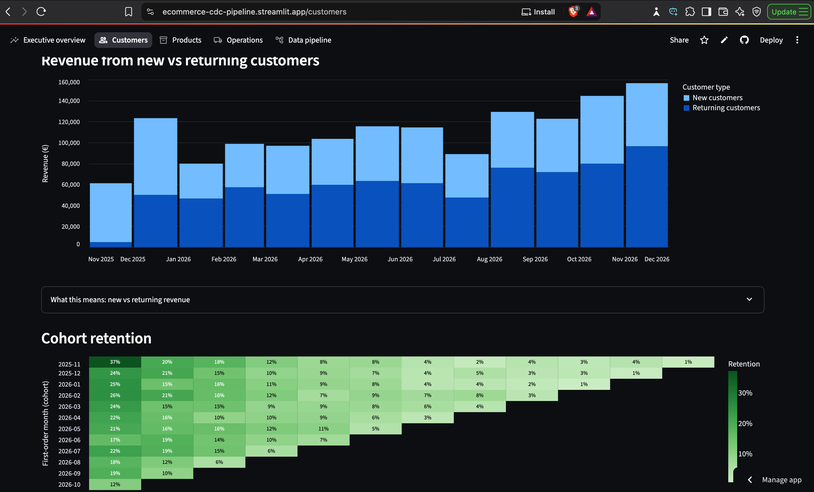 | 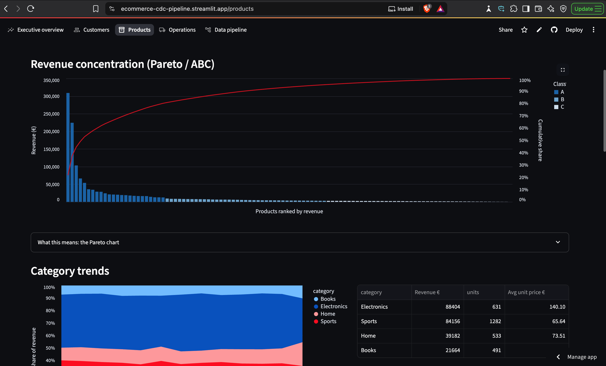 |

| Operations | Data pipeline |
|---|---|
| 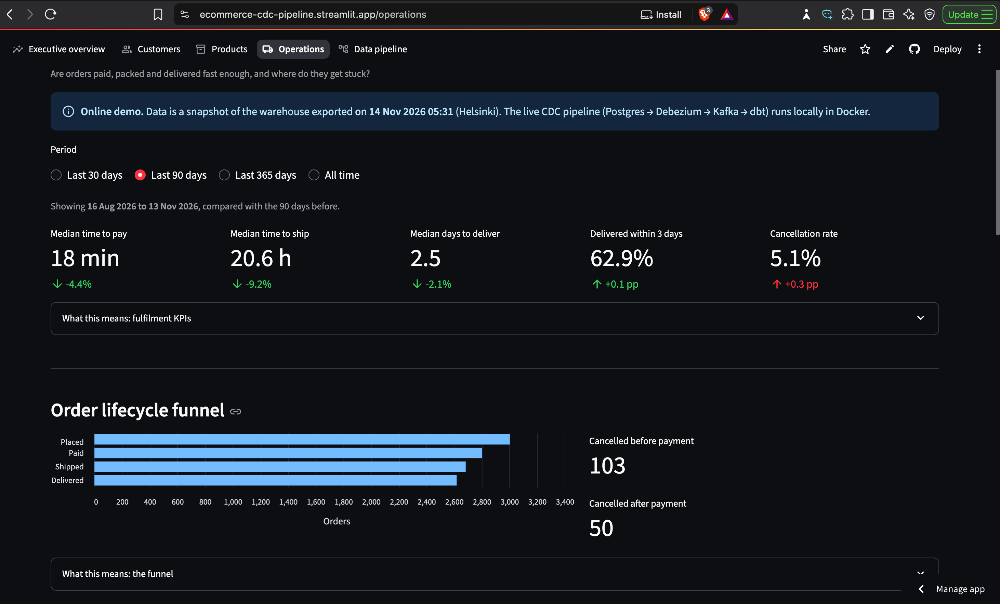 | 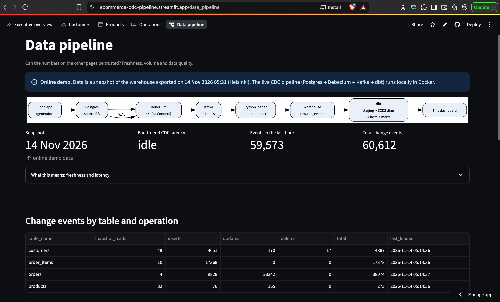 |

---

## Key engineering decisions

- **CDC instead of nightly batch copies.** A batch copy only sees the final state of each row. CDC captures every intermediate change (each status step, each move, each price), which is what makes SCD2 history, lifecycle timing and price elasticity possible.
- **SCD2 from change events, not dbt snapshots.** Snapshots compare table states when they run, so two changes between runs collapse into one. Building versions from the event stream keeps every change.
- **Business time vs system time.** Validity windows use the application's `updated_at` (when something happened in the shop), not Debezium's commit time (when it reached the database). This is what lets historical backfills produce correct history.
- **ELT with an immutable raw layer.** Events are stored unchanged, including the full payload. Any modelling bug is fixed by changing dbt and rebuilding; nothing upstream is lost.
- **Exactly-once results from at-least-once delivery.** Offsets committed after writes, plus a unique key on Kafka coordinates, plus deduplication on LSN in staging.
- **Exact money.** Debezium is configured with `decimal.handling.mode=string`, so prices never pass through floating point.
- **DuckDB for the public demo.** The dashboard runs on the live Postgres warehouse locally and on an exported DuckDB file online: no database server, no credentials and nothing that pauses when idle.

## Data quality

`dbt build` runs **55 tests**, including:
- uniqueness and not-null on every key, accepted values for statuses and CDC operations
- relationships from facts to the exact dimension versions
- **no overlapping SCD2 windows** and **exactly one current version** per customer and product
- **revenue reconciliation**: the daily KPI mart must equal the sum of order lines to the cent
- source freshness on the raw CDC table

CI runs `dbt build` on a fresh Postgres and opens every dashboard page on every push.

---

## Run it locally

**Prerequisites:** Docker Desktop (5 GB memory), Python 3.11+, Git.

```bash
git clone https://github.com/munyingi/ecommerce-cdc-pipeline.git
cd ecommerce-cdc-pipeline
cp .env.example .env
python3 -m venv .venv && source .venv/bin/activate
pip install -r requirements.txt

# 1. start Postgres, Kafka, Kafka Connect, Kafka UI and the warehouse
docker compose up -d

# 2. register the Debezium connector
curl -X POST -H "Content-Type: application/json" \
  --data @connectors/postgres-source.json http://localhost:8083/connectors

# 3. backfill 12 months, load it through CDC, build the warehouse, open the dashboard
./scripts/update_and_launch.sh
```

Then, optionally, start the live shop in another terminal: `python generator/generate.py --rate 2`.

| Service | URL |
|---|---|
| Dashboard | http://localhost:8501 |
| Kafka UI | http://localhost:8080 |
| Kafka Connect REST | http://localhost:8083 |
| Source Postgres | `localhost:5433` |
| Warehouse Postgres | `localhost:5434` |

To refresh the online demo: `python scripts/export_duckdb.py`, then commit and push
`dashboard/data/warehouse.duckdb`.

## Project structure

```
├── docker-compose.yml          # source DB, Kafka, Kafka Connect, Kafka UI, warehouse
├── postgres/init/              # source schema (logical replication ready)
├── warehouse/init/             # raw.cdc_events landing table
├── connectors/                 # Debezium connector config
├── generator/                  # live activity generator + 12-month backfill
├── consumer/                   # idempotent Kafka → warehouse loader
├── dbt_shop/                   # staging, SCD2 dimensions, facts, marts, tests
├── dashboard/                  # Streamlit app (views/, db.py, DuckDB snapshot)
├── scripts/                    # one-command refresh, DuckDB export
├── tests/                      # dashboard smoke tests (CI)
└── images/                     # screenshots used in this README
```

## Limitations and next steps

- The online dashboard is a snapshot; the streaming pipeline runs locally in Docker.
- History before CDC started is only known from the initial snapshot (true for any CDC system).
- Price elasticity is observational (seasonality and campaigns also move demand); a real pricing team would confirm it with A/B tests.
- Next: Avro with Schema Registry and a schema-evolution demo, a dead-letter queue, Prometheus/Grafana for consumer lag and replication-slot size, PII masking in staging, and orchestration with Dagster.

## Author

**Samwel Kamau Munyingi** · [LinkedIn](https://www.linkedin.com/in/samwel-munyingi-352a88161) · [GitHub](https://github.com/munyingi)
